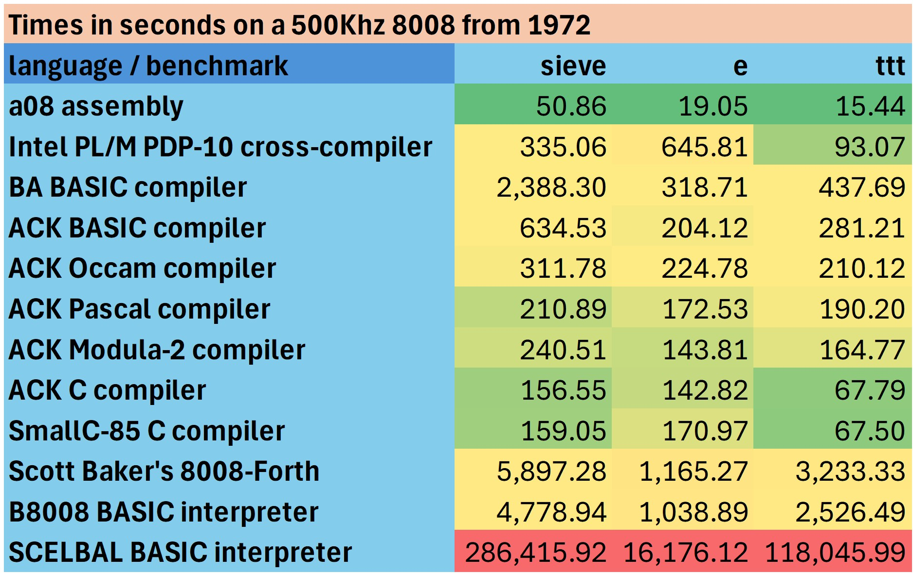

# ntv8008

A portable Intel 8008 emulator, native compiler backends and runnable examples.
The emulator implements the full instruction set, 16 KiB of RAM, console I/O,
instruction tracing and cycle accounting. Programs execute 8008 machine code;
compiler frontends and interpreters do not run inside the host as shortcuts.

This builds and runs on Windows, MacOS, and Linux (tested on Ubuntu).

Project code is **BSD-3-Clause**. Included third-party components retain their
own permissive terms. See [THIRD_PARTY_NOTICES.md](THIRD_PARTY_NOTICES.md) and
[PROVENANCE.md](PROVENANCE.md) for the exact publication boundary. Historical
components with restricted or unresolved permissions are optional local inputs,
not part of the published source or binary images.

## Contents

| Path | Contents |
| --- | --- |
| `i8008.cxx`, `i8008.hxx` | Complete 8008 CPU implementation and embedding interface; instruction decoding, flags, interrupt injection, RAM access and clock-period accounting. |
| `ntv8008.cxx`, `trace.hxx` | Command-line host, Intel HEX loader, keyboard/console callbacks, speed limiting and optional debug/instruction tracing. |
| `a08/` | Original assembly demos and sieve/e/TTT benchmarks, Robson's adapted MIT interpreter, runnable HEX images, and scripts for the official A08 dependency. |
| `ack/` | ACK EM-to-8008 code generator, RAM-stack runtime, optimizer passes, host bootstrap, C/Pascal/Modula-2/BASIC/Occam integrations and examples. |
| `smallc/` | Preserved SmallC-85 frontend, new 8008 code generator/runtime, host build scripts, C benchmarks and ANSI Snake. |
| `robson/` | Original MIT Tiny BASIC source/license, console adaptation and small BASIC examples. |
| `scelbal/`, `forth/`, `plm8/` | Optional historical-language integration tools and project-authored examples; restricted or uncleared interpreter/compiler images are not bundled. |
| `tests/` | Native CPU tests, integration/console checks, compiler regression and differential tests, benchmark references and publication checks. |
| `tools/` | Verified dependency fetching/building, benchmark runner and publication-inventory audit. |
| `LICENSE`, `THIRD_PARTY_NOTICES.md`, `PROVENANCE.md` | Project BSD license, retained third-party licensing references and source provenance. |

## Write your own programs

The [first-program guide](docs/first-program.md) walks through creating, building,
running and modifying an application. [Starter projects](starters/README.md) for
SmallC, b8008 BASIC, assembly and ACK C include Windows/Linux build/run wrappers,
recorded input and a small checked array lookup. Copy one to the ignored `work/`
folder to begin a project without changing the supplied examples.

## Build and run

Full setup on Linux/macOS requires a C++11 compiler, C compiler and Python 3.8 or newer.
Windows builds use Python 3 and a Visual Studio developer command prompt.
Building the emulator alone needs only the C++ compiler; running it needs no
Python, assembler or compiler frontend. Checked-in HEX examples work immediately:

```sh
git clone https://github.com/davidly/ntv8008.git
cd ntv8008
./m.sh
./ntv8008 -p a08/hello.hex
./ntv8008 -p ack/examples/sieve.hex
```

Windows equivalents:

```bat
m.bat
ntv8008.exe -p a08\hello.hex
ntv8008.exe -p ack\examples\sieve.hex
```

To fetch/build A08, rebuild the project assembly examples and Robson Tiny BASIC:

```sh
./setup.sh
./ntv8008 a08/echo.hex
./ntv8008 -l:robson/examples/hello.bas a08/robson.hex
```

On Windows use `setup.bat`. `PYTHON` can select another Python 3 command.
Setup writes only inside this directory and makes no system-wide installation.
Downloaded archives are checksum-verified; network access is needed only for
uncached dependencies. A08 is fetched from its official site, not bundled.

## Compilers and interpreters

| Tool | Included here | Rebuild |
| --- | --- | --- |
| A08 assembly | Project examples and runnable HEX; assembler fetched separately | `./a08/rebuild.sh` |
| [ACK C](ack/README.md) | New 8008 backend/runtime, examples, HEX; frontend downloaded | `python3 setup.py --ack` |
| [ACK Pascal](ack/pascal/README.md) | Same backend, original Pascal support, examples and HEX | `python3 setup.py --ack` |
| [ACK Modula-2](ack/modula2/README.md) | Same backend, original InOut support, examples and HEX | `python3 setup.py --ack` |
| [ACK Occam 1](ack/occam/README.md) | Sequential subset, original console runtime, five examples and HEX | `python3 setup.py --ack` |
| [ACK integer BASIC](ack/basic/README.md) | Same backend, original BASIC runtime, examples and HEX | `python3 setup.py --ack` |
| [SmallC-85 C](smallc/README.md) | Permitted frontend source, new backend/runtime, examples and HEX | `python3 setup.py --smallc` |
| [Robson Tiny BASIC](robson/README.md) | MIT interpreter, adaptation, examples and HEX | `python3 setup.py` |
| b8008 integer BASIC | Original BSD interpreter, byte/word arrays, full benchmarks | [b8008 guide](b8008/README.md) |
| SCELBAL floating-point BASIC | Integration and examples; optional noncommercial download | [SCELBAL setup](scelbal/README.md) |
| Baker 8008-Forth | Integration, native additions and examples; kernel not included | [Local-source setup](forth/README.md) |
| Intel PL/M-8 | Runner, recovery tool and example sources; compiler/output images not included | [Local-image setup](plm8/README.md) |

`./setup.sh --all` or `setup.bat --all` builds the default tools, SmallC and all
five ACK frontends, then rebuilds their examples. Native Windows ACK setup uses
Python and Visual Studio 2022/MSVC. It builds bundled Berkeley Yacc and Reflex,
downloads/builds pinned MIT Lua and ACK sources, and generates every parser/table
locally. No WSL, MSYS2, GNU Make, GCC, flex, or bison installation is needed.
See [the native Windows build guide](ack/MSVC.md).

Unix ACK builds require GNU Make 4.x, `ninja`, `gcc`, `flex`, `yacc`, and
`bison`, plus the usual C/C++ tools. ACK invokes both parser-generator commands;
having Berkeley `yacc` alone does not satisfy its Bison requirement. On
Ubuntu/Debian, install them with
`sudo apt install build-essential ninja-build flex bison`. On macOS, use
`brew install make ninja flex bison` and put the installed tools on PATH;
setup automatically uses Homebrew's `gmake`. `ACK_TOOLS` can select an
existing compatible host toolchain on either platform. Supplied HEX images run
without any host compiler. Bundled generator notices are recorded in
[THIRD_PARTY_NOTICES.md](THIRD_PARTY_NOTICES.md).
This product includes software developed by the University of California,
Berkeley and its contributors.

All full compiler integrations include sieve, e and tic-tac-toe benchmarks.
Robson's byte-only Tiny BASIC lacks the arrays/precision needed for these full
benchmarks; its own small examples exercise its supported dialect instead.

## Console, options and tracing

Input port 2 supplies a seven-bit character with bit 7 set when ready. Output
physical port 10 (octal 12) writes to the console. Status port 1 returns 0x80
when a character is ready, or zero otherwise, without consuming it or waiting.
Polling EOF returns zero; a blocking input read still exits on EOF.
`--in:port` also moves the default status port to the preceding port (modulo 8);
`--status:port` overrides that choice. Input and status ports must differ.
Keyboard handling uses portable C/C++ plus the appropriate Windows/POSIX console
primitives. Ctrl-C interrupts execution and restores the terminal. Windows
console output enables ANSI processing and restores its original mode on exit.

```sh
./ntv8008 -p a08/sieve.hex
./ntv8008 -t -i -n:100000 a08/hello.hex
./ntv8008 -l:robson/examples/hello.bas a08/robson.hex
./ntv8008 a08/robson.hex < robson/examples/hello.bas
```

`-p` prints emulated clock periods and an approximate runtime at the original
500 kHz clock; host I/O waits are excluded. `-t` creates `ntv8008.log`, and `-i`
adds per-instruction tracing. `-n:count` sets a cycle budget. The default entry
is 0x40; run the emulator without a filename to see all options. All 16 KiB are
RAM; the emulated hardware stack has seven saved return-address slots, while
compiler integrations use software stacks in RAM for deeper calls.

Sieve makes ten passes over 8191 odd candidates and prints 1899 primes. E prints
192 digits. Most compiled TTT examples run ten iterations; assembly, b8008,
and SCELBAL run one. Divide total TTT cycles by the iteration
count for comparisons.

## Snake at 500 kHz

Snake is written in SmallC, with assembly helpers for nonblocking keyboard
polling and a cycle-based delay. The runnable image is included:

```sh
./m.sh
./ntv8008 -s:500000 smallc/examples/snake.hex
```

On Windows, run `m.bat`, then
`ntv8008.exe -s:500000 smallc\examples\snake.hex`.
Use an ANSI-compatible terminal at least 34 columns by 23 rows. WASD steers
(upper or lower case), Q quits, and Ctrl-C interrupts. Reversing directly into
the snake is disallowed. Eat `*` to grow; walls and the snake's body end the game.

At the original 500 kHz clock, the board takes about three seconds to draw;
ordinary movement runs at about five moves per second. Only the new head,
departing tail, food and score changes are drawn. The game uses a circular body
buffer and occupancy map, so moving a longer snake does not require scanning
its body. The delay uses emulated instructions rather than a host clock; other
clock rates scale the game speed. CPU timing does not simulate serial baud rate.

Rebuild with `python3 smallc/compile.py smallc/examples/snake.c` after
`setup.py --smallc`, or use `smallc/rebuild.sh` / `smallc\rebuild.bat`.
`tests/snake.py` checks the supplied image, ANSI output, and console polling;
`--compile` also checks game rules and keyboard/timing helpers. Root test scripts
include these checks. Snake is interactive and is excluded from `perfrun`.

## Build and test scripts

| Script | Purpose |
| --- | --- |
| `m.sh` / `m.bat` | Build just the optimized console emulator. |
| `setup.sh` / `setup.bat` | Build the emulator, fetch/build A08 and regenerate the assembly demos and Robson interpreter. `--all` also builds available host compiler toolchains. |
| `a08/rebuild.sh` / `a08/rebuild.bat` | Reassemble the project assembly examples; accepts individual source filenames. |
| Each compiler's `rebuild.sh` / `rebuild.bat` | Recompile that language's examples after its host tools are available. |
| `test.sh` / `test.bat` | Build and run native CPU tests, then all available integration and compiler runtime tests. `--compile` also exercises compiler frontends and checks regenerated images. |
| `test_basic.sh` / `test_basic.bat` | Run the slow full SCELBAL benchmark tests when the optional interpreter has been installed. |
| `perfrun.sh` / `perfrun.bat` | Build the host and run installed sieve/e/TTT images with cycle and timing reports. |

```sh
./setup.sh
./test.sh
./setup.sh --all
./test.sh --compile
./perfrun.sh
```

Windows: `test.bat`, `test.bat --compile` after `setup.bat --all`, and
`perfrun.bat`. Tests include CPU instructions, cycle counts, HEX validation,
keyboard/terminal behavior, source regeneration, native compiler differential
tests and reference benchmark results. Missing optional historical components
are explicitly skipped. Windows skips the POSIX terminal-restoration test.
Full optional SCELBAL benchmarks: `./test.sh --basic-benchmarks`.

[GitHub Actions regression tests](https://github.com/davidly/ntv8008/actions/workflows/regression.yml)
run on every push and pull request, and can also be started manually. Linux
builds all five ACK frontends and SmallC before running `test.sh --compile`.
Windows builds all five ACK frontends and SmallC natively with MSVC before
running `test.bat --compile`. Both platforms include starter projects, b8008,
compiler rebuilds and differential checks. Optional PL/M, Forth, and SCELBAL
inputs are not downloaded by CI, so unavailable tests report explicit skips.

Validation covers all instruction encodings, arithmetic and branch behavior,
clock counts, HEX loader errors, redirected/file/interactive input, terminal
restoration, and native generated code against unoptimized/reference behavior.
Benchmark outputs are checked against independent prime, decimal and minimax
references. See [VALIDATION.md](VALIDATION.md) for the tested platforms and scope.

## Performance

The emulator runs as fast as the host allows by default. `-s:500000` limits it
to the original 500 kHz clock rate; `-p` reports both host elapsed time and an
estimated real-8008 runtime. The latter is `clock periods / 500000`, independent
of host speed, with no memory wait states or host I/O delays included.

The original [b8008 integer BASIC](b8008/README.md) runs all three benchmarks
with checked byte/word arrays and 16-bit integer arithmetic. Its full sieve flag
array fits in RAM, avoiding SCELBAL's small segmented arrays. The interpreter
and its HEX image are included under BSD-3-Clause; setup needs no historical
BASIC download. Select it with `--languages b8008` in either performance script.

A recent b8008 pass cuts sieve, E and TTT time by 12.3%, 9.2% and 10.1% (to
4,778.9, 1,038.9 and 2,526.5 seconds) while shrinking the interpreter by 74 bytes;
see [the b8008 notes](b8008/README.md).

The performance script reports unavailable optional languages and runs every
installed benchmark with `-p`. To select a subset:

```sh
./perfrun.sh --languages assembly ack pascal modula2 smallc
```

Measured on 2026-11-05 from the current images and locally installed optional
components. Values are estimated **seconds on a 500 kHz 8008**, independent of
host speed. Sieve includes ten passes; TTT is normalized to one iteration.



[Download the formatted workbook](docs/8008-runtimes.xlsx) for the full-precision
values, code/data/BSS RAM totals and notes, and the separate Z80 comparison.
The image is exported from `Sheet1!B3:E16` of that workbook. The BA BASIC row
uses the separate BA compiler's packed sieve, e, and one-dimensional TTT programs.

ACK and SmallC share conservative native optimizations for byte locals,
register/flag liveness, and frame addresses. Byte values can stay in otherwise
free C/D registers across branches; RAM remains authoritative around calls.
Frame addresses can stay in CD where liveness permits, or reuse HL with explicit
page-crossing adjustments. ACK keeps expression results in AB across eligible
joins instead of pushing and immediately popping them. SmallC also avoids
stacking local assignment addresses, including conditional expressions, and
tracks byte-comparison branch edges when calculating frame offsets.

C TTT still uses recursive minimax, ascending moves, the three opening positions,
and 6493 nodes per iteration. This revision reduces ACK C from 218.8 to 184.5
seconds per iteration (15.7% fewer clocks) and SmallC from 209.1 to 152.5 (27.1%).
The general RAM-stack calling convention is retained; reserving scratch registers
throughout every function would require additional save/restore traffic.

The C benchmarks now inline the last-move winner switch inside `minmax()`,
returning the score directly when a winning line is found. This source change
further lowers TTT to 152.3 seconds for ACK C and 131.2 for SmallC. The recursive
search, ascending moves, and 6493-node workload are unchanged.

Pascal, Modula-2, and Occam also inline their last-move winner dispatch.
This reduces TTT cycles by 8.0%, 13.3%, and 6.4%, respectively; their search
structure and data types are unchanged. Occam retains explicit search-frame
arrays instead of recursive search.

The next compiler/runtime pass leaves those sources unchanged and reduces
ACK C TTT from 152.3 to 145.3 seconds per iteration (4.6% fewer cycles), and
SmallC from 131.2 to 127.2 (3.1%). It fuses unsigned byte increments, uses
direct-memory byte comparisons and shorter zero-offset pointer loads, and
specializes ACK frame entry/exit and SmallC returns.

The latest SmallC pass lowers TTT further to **117.35 seconds per iteration**
(586,743,914 cycles for ten iterations), 7.72% fewer cycles than the previously
published 127.17 seconds. It uses direct byte comparisons, omits unused update
results, updates global counters' high bytes only on carry/borrow, skips proven
first byte-loop tests, simplifies byte-selector jump-table dispatch, and forms
indexed-load addresses directly from byte locals. TTT also shares one depth-parity
test when initializing `piece` and `value`; search order and node count are unchanged.
Shorter stack-pop helpers benefit SmallC and all five ACK frontends. SmallC sieve
and e now take **251.806988** and **248.524724 seconds**, respectively. See the
[SmallC](smallc/README.md) and [ACK](ack/README.md) notes for individual measurements.

The assembly benchmarks were reworked for the 8008's instruction timings:
sieve falls from 78.14 to **50.86 seconds** (34.9% fewer clocks), e from 36.53
to **19.05** (47.9%), and TTT from 28.91 to **15.44** per iteration (46.6%).
Outputs and workloads, including TTT's 6493-node search, are unchanged; see
[the a08 notes](a08/README.md) for details.

A further code-generation pass applies the same ideas to SmallC and the shared
ACK backend. It adds constant-address frames for `main`, a faster divide loop, rotated marking
loops, direct argument and indirect-store setup (SmallC), and byte loop counters kept in
registers across `continue`. ACK also gains inline constant multiplication and direct
byte stores. SmallC now takes **168.33**, **172.93** and **94.33 seconds** for
sieve, e and TTT (33.2%, 30.4% and 19.6% fewer clocks); ACK C takes **166.84**,
**163.72** and **114.21** (43.8%, 52.2% and 21.3% fewer). The other ACK frontends
improve by up to 40.9% (Modula-2 sieve). Outputs and benchmark sources are unchanged.

A further ACK pass targets the other frontends, whose EM the C-oriented lowering
had largely missed. Pascal, Modula-2, Occam and BASIC now run their benchmarks
41–71% faster: for example, Pascal sieve falls from 630.74 to **221.62 seconds**,
Modula-2 e from 495.80 to **144.47**, and BASIC TTT from 487.35 to **286.66** per
iteration. All ACK frontends also gain the following:

- short-lived expression words go to scratch slots instead of the RAM stack
- call arguments are stored into one reserved block
- multiplication uses shift-and-add, and division by a small divisor uses long division

ACK C e and TTT improve by 11.6% and 5.4%. See the [ACK notes](ack/README.md).

TTT now beats the 72 seconds WOPR needed in *WarGames* to conclude that
tic-tac-toe can't be won: SmallC takes **70.22 seconds** per iteration and ACK C
**71.02** (25.6% and 34.3% fewer clocks than before). Self-recursive functions
get a fast copy that addresses their frame from a low byte held in a register
whenever the whole activation lies in the stack's first page. Original code
runs when it doesn't. ACK also inlines its frame entry, exit, stack adjustments
and argument stores in that copy. The same fast copies take Modula-2 TTT from
197.28 to 167.47 seconds and Pascal from 215.80 to 192.06.

A shared peephole now drops register loads of a value the register already
holds on every path. TTT falls to **67.50 seconds** for SmallC and **67.79**
for ACK C. Sieve improves by 1–8% across the compilers (ACK C 156.55, SmallC
159.05 seconds), and every benchmark image is slightly smaller.

Occam now places eligible sequential procedure workspaces in static BSS,
including ttt's search arrays. This reduces target cycles by 56.9% for sieve,
9.8% for e, and 55.0% for ttt, without changing the algorithms, array sizes or
outputs. Its driver falls back to stack storage when static workspace would
leave insufficient RAM. The workbook includes the relocated arrays in BSS.

ACK BASIC now folds constant FOR steps, tests a variable step's sign once per
loop instead of on every iteration, and compares word variables directly.
Sieve falls from 975.65 to **634.53 seconds** (35.0% fewer clocks); e and TTT
improve slightly, to 204.12 and 281.21. The other frontends' images are
unchanged. See the [ACK BASIC notes](ack/basic/README.md#for-loop-and-comparison-performance).

Sieve includes all ten passes; E produces 192 digits. TTT is normalized to one
iteration (6493 search nodes). Assembly, b8008 and SCELBAL run one TTT iteration;
ACK languages, SmallC, PL/M and Forth run ten, so divide their reported total
TTT runtime by ten. Interpreter measurements include loading/compiling the
example source. Forth includes the `DO`/`I` and `UNLOOP EXIT` TTT refactor.
Robson's byte-only Tiny BASIC cannot run these full workloads.

Optional results are measured from locally supplied components; their images
are excluded from the published bundle. See the [Forth](forth/README.md),
[PL/M](plm8/README.md), and [SCELBAL](scelbal/README.md) setup guides.
SCELBAL uses a segmented sieve and a different fixed-point e algorithm to fit
its floating-point arrays; its results are not a direct comparison of identical
algorithms. Forth packs sieve flags into bits. All implementations retain the
stated output sizes, sieve pass count, and TTT search workload.

Run `./perfrun.sh` (Windows: `perfrun.bat`) to measure every installed integration;
unavailable optional components are reported as skipped. For just the optional
rows, use `--languages forth plm8 basic` (`basic` selects SCELBAL).

The compiler backends use software stacks in RAM, direct constant/array access,
constant arithmetic lowering, quotient reuse and register retention for recognized
loops. The compact 8008 targets provide language/runtime subsets sized for
16 KiB. Individual language READMEs document supported subsets, memory layout and optimization
history. Performance can change as code generation improves; rerun the script
when comparing revisions.

## Licensing and publication inventory

`publication-manifest.json` is the initial reviewed source inventory with hashes
and licensing categories. `python3 tools/publication.py` checks its hashes and
ensures Git's publication candidates exactly match that inventory. Intentionally
modified sources require review before `python3 tools/publication.py --update`.
Downloaded dependencies, historical local inputs, logs, listings, object files
and emulator/assembler binaries are ignored. Do not force-add them or publish a
raw working-directory ZIP. Preserve third-party notices in releases as well as
source checkouts. No GitHub repository is created or pushed by setup.

Programming help: [machine and language reference](docs/programming.md),
[debugging and symbol maps](docs/debugging.md).

More programming resources: [choose a language](docs/languages.md),
[practical games](examples/README.md), [optimization walkthrough](docs/optimization.md),
and [testing your programs](docs/testing.md). Starter builds generate adjacent
symbol maps; `-t -i` automatically uses them without a `-m` argument.

[Hunt the Wumpus](examples/wumpus/README.md) runs from one shared C source with
either SmallC or ACK C, including human and computer play.

[Host emulator performance](docs/emulator-performance.md) records parity and
opcode-dispatch measurements and commands for reproducing them.
